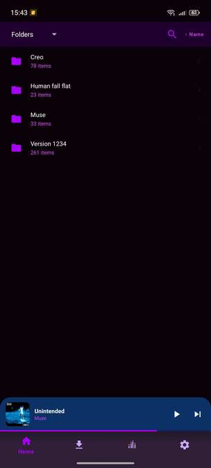
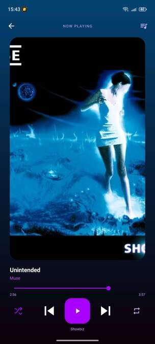
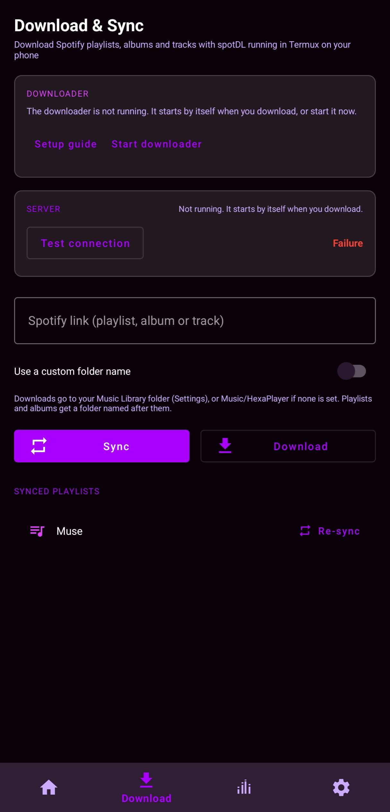
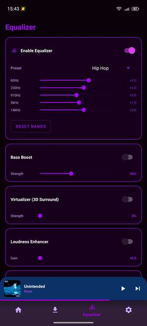
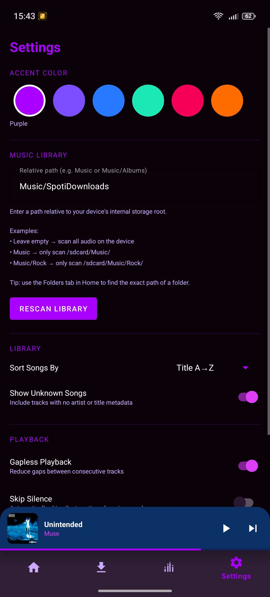

# HexaPlayer

A **free**, open-source music player for Android. (No ads, no tracking, no shit)


HexaPlayer plays the music already on your phone, fast and without distractions. It also comes with an optional downloader to bring your Spotify playlists, albums and tracks onto your phone and keep them in sync, all locally.

## Features

### Your library
- **Browse** by Songs, Albums, Artists, Playlists or Folders, with search and sorting everywhere
- **Albums view** only shows real albums: singles stay in Songs, Artists and Folders
- **Playlists** with custom covers; add songs one by one or **a whole album at once** (long press an album, or the **+** in its page)
- **Edit song info** (title, artist, album, cover) from the 3-dot menu
- **Choose your library folder** in Settings to only show the music you care about

### Playback
- **Full-screen player** with seekbar, shuffle, repeat, lyrics and the queue
- **Smart queue**: playing a song queues the rest of its album; Play Next, Add to Queue, drag and drop to reorder
- **Lyrics**: synced (LRC) and plain lyrics from [LRCLIB](https://lrclib.net)
- **Equalizer**: 10 bands, bass boost, virtualizer, loudness enhancer and reverb
- **Sleep timer**: 15 / 30 / 45 / 60 minutes or any custom duration
- **Swipe the app away to stop the music**, unless Android Auto is using it

### Download & Sync (optional)
- Paste a **Spotify link** (playlist, album or track) and the music lands in your library folder, named after the playlist or album
- **Sync** keeps a playlist up to date: new songs are added, removed ones are deleted. Synced playlists can be re-synced in one tap
- **Stop** any download, **run it again** later: songs already on your phone are skipped
- Runs [spotDL](https://github.com/spotDL/spotify-downloader) inside **Termux**, on your phone. No account, no server, nothing leaves your device
- HexaPlayer starts the downloader only when you need it, and it stops by itself when idle
- A step by step **setup guide** is built into the app. Details in the [Termux guide](termux/README.md)

### Everywhere else
- **Android Auto**: browse Songs, Albums, Artists, Playlists and Folders, with voice search
- **Widgets**: 4×1 and 5×1 home screen widgets with album art and controls
- **In-app updates**: get notified and install new versions directly
- **Accent colors**: 6 presets to match your style

## Screenshots

<p align="center">
  
  
  
  
  
</p>

## Download

Grab the latest APK from the [Releases page](https://github.com/OxoGhost01/HexaPlayer/releases/latest) and install it. The app then updates itself.

- Android 8.1 or newer
- Access to your audio files (asked on first launch)
- For Download & Sync only: the free [Termux](https://f-droid.org/packages/com.termux/) app (from F-Droid or GitHub, not the Play Store)

## Permissions

HexaPlayer only asks for what it needs to play your music, nothing more.

| Permission | Why | When |
|---|---|---|
| **Music and audio** (`READ_MEDIA_AUDIO`, or `READ_EXTERNAL_STORAGE` on Android 12 and older) | Find and play the songs on your phone | First launch |
| **Notifications** (`POST_NOTIFICATIONS`, Android 13+) | Show the playback controls notification and update alerts | First launch |
| **Run in the background** (`FOREGROUND_SERVICE`, `FOREGROUND_SERVICE_MEDIA_PLAYBACK`, `WAKE_LOCK`) | Keep the music playing with the screen off or the app in the background, and work with Android Auto | Granted automatically |
| **Internet** (`INTERNET`) | Fetch lyrics from LRCLIB, check GitHub for updates, and talk to the downloader running on your own phone | Granted automatically |
| **Install apps** (`REQUEST_INSTALL_PACKAGES`) | Install HexaPlayer updates from inside the app | Only when you tap Update |
| **Run commands in Termux** (`com.termux.permission.RUN_COMMAND`) | Start the downloader in Termux for you | Only if you enable Download & Sync |
| **Storage write** (`WRITE_EXTERNAL_STORAGE`, Android 9 and older only) | Save downloaded music | Only if you use Download & Sync |

When you edit a song's info, Android asks you to confirm the change for that file, each time.

No location, contacts, camera, microphone or account access. No analytics, no ads, and nothing about you or your music is ever sent anywhere.

## 2.0 is coming

Version 1.5 is the last big update of the 1.x line. HexaPlayer 2.0 is in the works, with a brand new interface, the ability to open any music file with the app, and more surprises. Here is what is planned so far:

## Planned Features

- **Open with** : open a song in the app even if it's not in your library
- **Remember queue** : remember the last played song
- **Shazam** integration
- **Wrapped** : a resume of the year
- **New UI** (+ more personalization options)

## Tech Stack

| Layer | Library |
|---|---|
| Language | Kotlin 2.4 |
| UI | Views + ViewBinding |
| Media | Media3 1.11 (ExoPlayer, MediaSession, MediaLibraryService) |
| Image loading | Coil 3 |
| Persistence | SharedPreferences + Gson |
| Architecture | MVVM: ViewModel + LiveData + Repository |
| Downloader | spotDL in Termux, behind a small local FastAPI server ([termux/](termux/)) |

## Building

1. Clone the repo
2. Open it in a recent Android Studio (Android SDK 36 and JDK 17)
3. `Build → Make Project`, no extra setup needed

```bash
git clone https://github.com/OxoGhost01/HexaPlayer.git
```

## License

[Non-Commercial License](LICENSE): free to use and modify for any non-commercial purpose.
